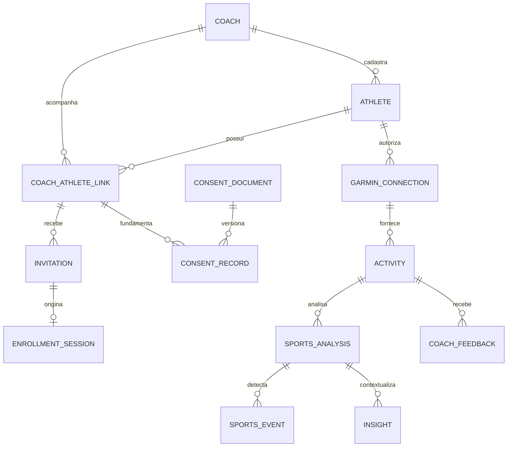

# Modelo de domínio inicial

Status: conceitual; não é schema Prisma implementado. Data: 2026-11-11.

## Entidades e invariantes
| Entidade | Campos conceituais e regras |
| --- | --- |
| User (candidato) / Coach | Identidade autenticada e perfil esportivo são responsabilidades distintas. Proposta MVP: issuer/subject únicos no Coach, sem tabela User separada enquanto só existir treinador autenticado; separar User quando houver ciclo de vida/perfis adicionais reais. |
| CoachSession | hash de token opaco, coachId, expiração e revogação; não guardar cookie em claro. |
| Athlete | id, coachId, nome, emailNormalizado, estado; e-mail não é prova de identidade nem chave global. |
| CoachAthleteLink | id, coachId, athleteId, estado pending/active/ended, início/fim; um vínculo corrente por par, histórico preservado. |
| Invitation | coachId, athleteId, linkId, tokenHash único, expiresAt, revokedAt, consumedAt e destinatário esperado; estado pending/used/expired/revoked derivado desses campos com transições consistentes; token nunca persistido em claro. |
| EnrollmentSession | convite resgatado, hash de capability, expiração, estado e verificação de e-mail; acesso apenas à própria jornada pública. |
| ConsentDocument | finalidade, versão, hash e referência do texto imutável publicado. |
| ConsentRecord | coachId, athleteId, linkId, documento, decisão, instante e evidência mínima; retirada append-only, não sobrescrever aceite anterior. |
| GarminConnection | coachId, athleteId, provider, identificador externo protegido, estado not_connected/awaiting_authorization/connected/error/disconnected, tokens cifrados, keyVersion e timestamps; separada do consentimento. |
| AuthorizationAttempt | connectionId, enrollmentSessionId, hash de state, expiração, consumo e material PKCE protegido se exigido. |
| IntegrationEvent | provider, identidade de entrega/escopo oficial, hash, raw protegido, estado e horário; inbox durável. |
| ProcessingJob | tenant, referência, etapa, versão, tentativas, availableAt, lease e erro sanitizado. |
| Activity | coachId, athleteId, connectionId, externalId, source, isSynthetic, modalidade, início UTC, timezone, revisão, métricas e qualidade. |
| ActivitySample / Split | activityId, timestamp/índice, unidades e medidas opcionais; preservar ausência, ordem e proveniência. |
| SportsAnalysis | activityId, revisão de entrada, versão de algoritmo, status, métricas derivadas e qualidade. |
| SportsEvent | analysisId, regra/versão, intervalo, evidências, limiar e limitações; não é diagnóstico médico. |
| Insight | analysisId, tipo fact/event/hypothesis/recommendation, texto, evidências, versão e estado; hipóteses distinguíveis. |
| AIRun | coachId, escopo, referências/revisões de entrada, prompt/model version, provider, status, consumo e saída validada; minimizar conteúdo persistido. |
| CoachFeedback | coachId, activityId, análise/insight opcional, autor, observação/decisão, escopo (atividade/km/intervalo), origem do contexto (observado pelo coach/informado pelo aluno), revisão e timestamps; histórico de alterações. |
| MonitoringEvent / ReadState | coachId, tipo, recurso, horário e estado de leitura; projeção, não fonte de autorização. |
| AuditEvent | tenant, ator, ação, alvo, resultado, horário e correlationId; sem tokens ou raw pessoal. |

A referência de Feedback exige avaliações independentes para evento observado e hipótese causal. Modelar no feedback associado ao insight os campos observedEventVerdict (correct/partial/incorrect) e causalHypothesisVerdict (correct/partial/incorrect/unknown), ambos opcionais até avaliação, além de contexto textual. Não colapsar os dois em um único booleano; ausência de avaliação difere de “não sei”. Cada revisão mantém a referência à versão do insight avaliado.

Campos de identidade primária, createdAt e updatedAt onde cabível. Estados e enums definitivos serão fechados por etapa.

## Identidade e isolamento
Proposta conservadora: Athlete é cadastro do coach, não identidade universal do indivíduo. O coach define destinatário e e-mail antes de emitir convite. A página permite confirmar/corrigir nome; divergência de e-mail exige reemissão/verificação, nunca troca silenciosa de athleteId. Verificação de e-mail por código é recomendada antes de vincular Garmin; requer serviço transacional ainda não escolhido. Link encaminhado sozinho não deve ser tratado como prova da identidade correta. Política precisa ser aprovada antes da etapa de convites.

Todas as relações entre registros de tenant usam coachId + id no banco e nas consultas. Convite só pode ativar seu link/athlete preexistente. Credencial Garmin não concede acesso à UI. Não unir cadastros de coaches distintos por e-mail ou identificador Garmin. Caso a Garmin limite múltiplas autorizações da mesma conta por aplicação, a política acima deve ser revista antes de produção; nenhuma conexão pode ser transferida entre coaches implicitamente.

## Integridade, concorrência e versões
Consumo do convite é atualização condicional em transação: pendente, não revogado e expiresAt maior que agora. Somente um vencedor concorrente cria enrollment; a sessão de jornada permite retomada sem reutilizar token. Consentimentos e ativação de vínculo são persistidos atomicamente ao confirmar aceites; autorização Garmin ocorre depois e pode falhar independentemente.

Propor convite válido por 48 horas, enrollment por 30 minutos e tentativa OAuth por 10 minutos; valores configuráveis, pendentes de aprovação. Nova tentativa oficial exige capability válida e novo state. Não manter transação de banco aberta durante redirect externo.

Unicidade de atividade por provider + conexão + externalId, com índice por coach/aluno/data. Escopo de ID e revisões externas dependem do contrato oficial. Um evento pode ser repetido sem duplicar atividade; atualizações geram nova revisão e invalidam análises derivadas obsoletas. Resultado único por activityId + inputRevision + algoritmo/version. Persistir amostras em lotes; unidade canônica explícita (m, s, bpm, conforme métrica) e valor ausente como null, nunca zero fabricado.

Encerrar vínculo remove acesso e cancela processamento elegível. Revogar Garmin não apaga automaticamente evidência legal nem define prazo de retenção: políticas distintas precisam de aprovação e execução auditada.

## Responsabilidade, cardinalidade e persistência
Nomenclatura conceitual: CoachAthleteLink corresponde a CoachAthleteRelationship; ConsentRecord a Consent; SportsEvent a ActivityEvent; Insight a AIInsight quando produzido por IA; AuditEvent a AuditLog. Não criar entidades duplicadas apenas por nome.

Coach possui muitos cadastros Athlete e relacionamentos; cada relacionamento pertence a um coach e um cadastro. Cada convite pertence a um relacionamento e origina no máximo uma jornada resgatada. Uma conexão possui muitas atividades; a atividade possui muitas amostras/splits e revisões de análise. Atividade importada manualmente pode não ter connectionId: manter referência de importação e origem `manual_fit`, sem forjar conexão Garmin. Cada análise contém eventos e pode gerar insights; feedback tem autor treinador e referência à atividade, com aluno derivado e validado pela relação, sem aceitar associação divergente.

Persistir identidade/vínculo, convites/consentimentos, conexão e atividade quando suas sprints forem implementadas. Samples e splits podem ser tabelas ou blocos normalizados conforme volume/acesso; decidir na SPRINT 05 com consultas reais. Eventos podem pertencer ao agregado de análise; ReadState pode ser campo do MonitoringEvent enquanto houver um destinatário. Sessions, inbox/jobs e tentativas são necessidades técnicas, não tabelas obrigatórias de domínio. Métricas de dashboard são projeções calculadas inicialmente, sem tabela de contador independente. Nenhum desses modelos exige migrations na SPRINT 00.

O mecanismo público de revogação deve usar capability específica, expiração, uso único, confirmação de identidade e rate limit; não reutilizar convite consumido nem fornecer IDs livres. Solicitação de fim do vínculo tem estado e auditoria próprios, sem inventar estado adicional do vínculo. Detalhes do canal e da verificação precisam de aprovação na SPRINT 03.
