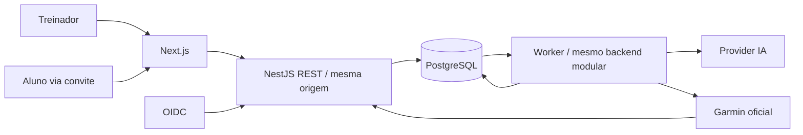

# Arquitetura inicial

Status: proposta para aprovação. Data: 2026-11-11. Decisão de stack: [ADR-001](../decisions/adr-001-stack.md).

## Diagnóstico
Diagnóstico atualizado: repositório já possui um commit inicial (`10c0e83`) publicado na main, com seis documentos e oito referências PNG. Esta revisão trabalha na branch `sprint/00-discovery`. Ainda não há aplicação, package manifest, Docker, migrations, CI ou testes executáveis. A afirmação de workspace vazio descrevia a primeira inspeção, não o estado atual. `AGENTS.md` passa a registrar regras permanentes nesta entrega.

As oito referências em `docs/design/references/` foram relidas nos dois temas: composição, sidebar, cards, gráficos e validação separada de eventos/hipóteses estão registrados no [inventário visual](../product/mvp-01.md). A cor principal é `#EF3338`, conforme contexto mestre.

## Topologia

Chamadas externas nunca ficam dentro de transações longas. UI não decide autorização. API verifica a sessão, ownership e vínculo em toda leitura/mutação, inclusive exportações, gráficos, IA, monitoramento e seleção de segmentos.

## Estrutura proposta — não criada nesta etapa
```text
apps/
  web/src/
    app/(coach)/
    app/(public)/convite/
    components/
    features/
    lib/
  api/
    src/
      main.ts
      worker.ts
      modules/
        auth/ coaches/ athletes/ invitations/ consents/
        garmin-connections/ activities/ activity-processing/
        sports-analysis/ insights/ ai/ coach-feedback/ monitoring/
      infrastructure/  # banco, fila, auditoria, secrets, logs
    prisma/
      schema.prisma
      migrations/
      seed.ts
    test/
packages/
  api-client/          # gerado de OpenAPI, quando houver API
infra/
  compose.yaml
  env.example
docs/
```
Não criar pastas vazias, pacote de domínio compartilhado com browser ou camadas abstratas sem uso. Organização interna dos módulos cresce conforme casos de uso; infraestrutura implementa portas do domínio. CI e configuração raiz serão adicionadas na fundação aprovada.

## Limites dos módulos
| Módulo | Responsabilidade e relações |
| --- | --- |
| Auth | OIDC, sessões e principal; não resolve consentimento esportivo. |
| Coaches | Perfil do treinador e configuração de conta. |
| Athletes | Cadastro do aluno e vínculo com coach; fonte da autorização do acompanhamento. |
| Invitations | Emissão, revogação, expiração e resgate; coordena Athletes e Consents atomicamente. |
| Consents | Versões de termos, finalidades, aceite e retirada; não representa OAuth Garmin. |
| GarminConnections | Credenciais, autorização, estado de sincronização e adapter oficial/mock. |
| Activities | Atividade normalizada, amostras, splits e consultas autorizadas. |
| ActivityProcessing | Inbox, fila, normalização, retry, deduplicação e orquestração do pipeline. |
| SportsAnalysis | Métricas derivadas e eventos determinísticos versionados. |
| Insights | Interpretações com evidências e estados de revisão; sem cálculo básico por LLM. |
| AI | Contexto autorizado, prompts, limites, provider e validação das respostas. |
| CoachFeedback | Observações e decisões autorais, revisão de insights e histórico. |
| Monitoring | Projeção de eventos e pendências por coach; não duplica estado de origem. |

Módulos chamam serviços públicos internos; não chamam controllers de outros módulos nem acessam arbitrariamente tabelas alheias. REST é transporte externo; worker reutiliza casos de uso. Eventos internos duráveis são registros transacionais, não um barramento distribuído. Auditoria é infraestrutura transversal.

## Isolamento e segurança
Proposta MVP: cadastro Athlete pertencente a um coach, sem fusão global por e-mail; vínculo continua entidade separada. Multi-coach para a mesma identidade real depende de decisão futura. Todas as tabelas de acompanhamento carregam coachId; chaves estrangeiras compostas impedem referenciar aluno/atividade de outro tenant. Consultas exigem coachId obtido da sessão, nunca confiado ao corpo da requisição. Jobs carregam tenant e revalidam consentimento/vínculo. Identificadores aleatórios não substituem autorização. RLS é defesa adicional a avaliar após definir conexão/pooling; não é pressuposta como implementada.

Sessões revogáveis, rate limit compartilhado por instância, DTOs validados, limites de payload e allowlists de filtros. Convites/callbacks sem cache público; dados autenticados não entram em cache compartilhado. Referrer-Policy e redação de logs protegem tokens. TLS, criptografia autenticada dos tokens Garmin com chave externa ao banco e rotação, acesso mínimo e backups protegidos. Auditoria registra ator, ação, alvo, tenant, horário e correlação, sem payload sensível ou segredo.

Revogar acompanhamento bloqueia imediatamente leitura e novos jobs; desconectar Garmin bloqueia coleta e inicia revogação externa. Exclusão é fluxo controlado incluindo derivados, IA e backups conforme retenção aprovada; registrar tombstone mínimo para impedir replay de eventos após exclusão. Não prometer exclusão instantânea de backups.

## Operação e testes
Logs JSON com correlationId, jobId e códigos de erro, sem nomes, e-mails ou séries detalhadas. Medir idade de fila, latência, falhas, duplicatas e última ingestão; nunca rotular métricas operacionais com dados pessoais. Health/readiness diferenciam banco, worker e providers. Secrets somente via ambiente/secret manager; exemplo contém nomes e placeholders.

Testes unitários para regras; integração com PostgreSQL real para constraints, concorrência e transações; E2E para coach A/B, convite, callback, revogação e replay. Seeds opcionais, determinísticos e sintéticos, proibidos por padrão em produção. OpenAPI, lint, Prettier, tipos, build e checks em CI. Sem testes executáveis nesta entrega documental.

## Proteção de dados
Tratar métricas de saúde como potencialmente sensíveis. Validar base legal por finalidade, papéis de controlador/operador, direitos do titular, transferência internacional, contratos e prazos com assessoria jurídica. Consentimento de acompanhamento e permissão Garmin são independentes; aceitar política não substitui definir base legal. Não enviar identidade ou rotas GPS à IA por padrão. Retenção de raw, normalizados, auditoria e backups precisa de tabela aprovada antes de produção.

Fonte jurídica primária: [LGPD, texto atualizado na Câmara](https://www2.camara.leg.br/legin/fed/lei/2018/lei-13709-14-agosto-2018-787077-normaatualizada-pl.html). As medidas acima são propostas técnicas, não conclusão de conformidade.

## Plano proposto para a SPRINT 01 — aguarda aprovação
1. Fixar runtime/pacotes estáveis compatíveis, pnpm workspace e scripts de desenvolvimento, build, lint, formatação e tipos.
2. Criar Next.js e NestJS mínimos, configuração validada, logs JSON sem secrets, health de processo e readiness com consulta real ao PostgreSQL via Prisma.
3. Compose inicialmente para banco; frontend/backend executados no host com pnpm, reduzindo custo de rebuild local. Containers de aplicação ficam como alternativa se paridade de ambiente for prioritária. Aprovar essa escolha antes da implementação.
4. Prisma configurado e estratégia de migrations versionadas, sem transformar todas as entidades conceituais em tabelas na fundação. Criar migration somente para persistência realmente necessária; não criar tabela artificial para justificar uma migration.
5. Design system inicial em componentes de `apps/web`, tokens CSS semânticos e Tailwind, cor `#EF3338`, sidebar responsiva e dark/light com preferência persistida. Sem pacote de UI independente por enquanto: menos manutenção, extraível se houver segundo consumidor.
6. Dashboard com fixtures determinísticas explicitamente sintéticas e aviso de demonstração. Nenhuma sessão falsa, conexão real simulada ou API de negócio pública. Itens de futuras sprints claramente indisponíveis/em desenvolvimento. Manter BalduTraining na marca visual e BalduCore na identificação técnica.
7. README, teste de health/readiness com banco real e indisponível, teste em browser de temas/sidebar e screenshots em desktop/tablet/mobile; builds, tipos, lint e formatação como gate.

Critério: frontend, API e banco executáveis localmente, dashboard demonstrativo coerente com referências, navegação acessível e adaptação responsiva. Não incluir autenticação, cadastro, convites, Garmin, upload FIT, IA ou worker funcional nesta sprint.

A fonte tipográfica exata e o asset original do logotipo não estão no ZIP. Recomenda-se aprovar uma fonte sans-serif provisória local/licenciada e marca textual fiel até receber os originais, sem redesenhar ou apresentar a escolha como fonte original. A decisão será visível na revisão visual.
