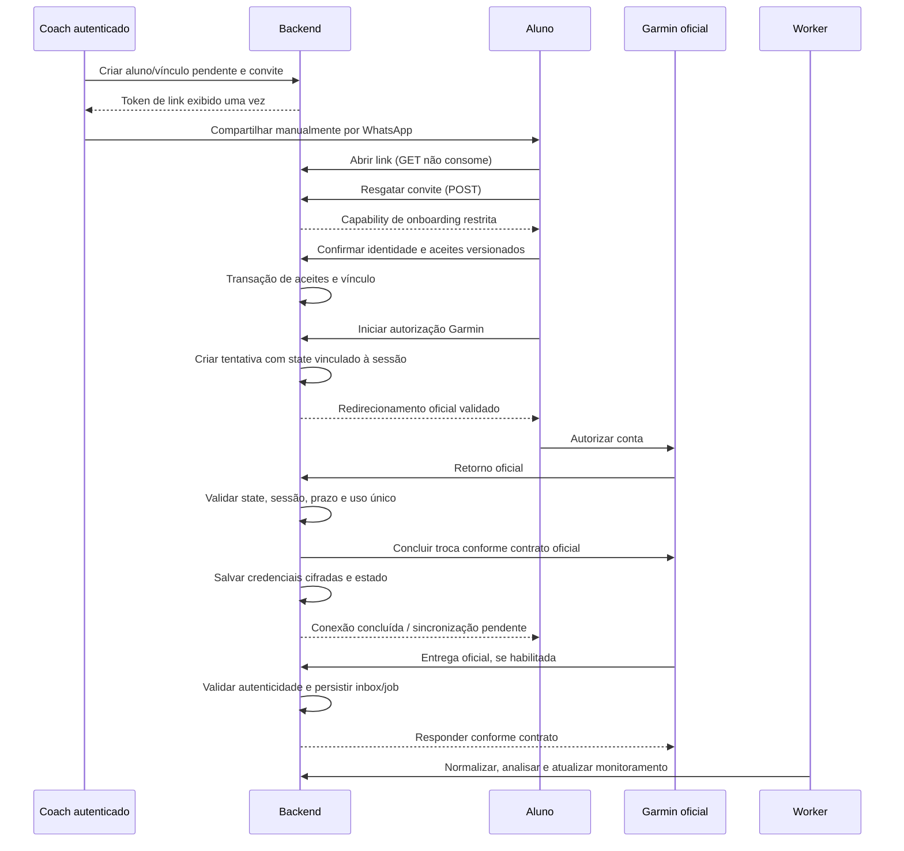

# Integração Garmin

Status: desenho técnico; nenhum endpoint, payload ou escopo Garmin foi implementado ou presumido. Data de consulta: 2026-11-11.

## Evidência pública e dependências
A [visão oficial do programa](https://developer.garmin.com/gc-developer-program/overview/) distingue Personal, Business Starter e Business Enterprise. Starter anuncia entrega push, capacidade limitada e ausência de histórico; Enterprise oferece alternativas de entrega e histórico conforme condições. Portanto, backfill e polling não são garantias do MVP. Personal destina-se aos próprios dados e não deve ser assumido como solução para alunos de uma plataforma comercial.

A implementação comercial depende de acesso Business adequado, credenciais, documentação privada e termos aprovados. A disponibilidade anunciada não prova aprovação da BalduTraining. O fluxo de autorização será confirmado no portal oficial: não deduzir endpoints, scopes, assinatura de callbacks, refresh, limites ou formato de atividades. URL antiga pública de Activity API consultada retornou 404 e não foi usada como contrato.

## Contrato interno — não representa API Garmin
Porta ActivityProvider com operações conceituais: iniciar autorização, concluir autorização, validar/normalizar entrega, recuperar dados apenas quando permitido, revogar e consultar estado local. Implementações GarminOfficialProvider e GarminMockProvider. DTOs internos descrevem identidade de origem, revisão, timestamp, unidades, disponibilidade e evidência de proveniência; o domínio não importa DTO Garmin.

Mock usa identificadores próprios, relógio controlável e dados isSynthetic=true/source=garmin_mock. Simula sucesso, recusa, expiração, duplicata, atualização, atraso, entrega fora de ordem, payload inválido, indisponibilidade e revogação. Não acessa contas reais. Inicialização de produção falha se provider mock estiver habilitado; seeds nunca criam conexão oficial.

## Convite e autorização

Token de convite com pelo menos 32 bytes aleatórios criptograficamente seguros; persistir somente hash. Não consumir em GET: previews do WhatsApp e scanners não podem esgotar convite. Remover token da URL após resgate, bloquear referrer e analytics na jornada e não registrar caminho com segredo. Erros públicos genéricos evitam enumerar alunos. Capability de onboarding não é sessão de coach.

State imprevisível, expira e é consumido atomicamente; PKCE e detalhes OAuth conforme documentação oficial. Vincular tentativa a coach, athlete, conexão e navegador. Callback não aceita athleteId/coachId livres para reassociação. Revalidar vínculo/consentimento antes de salvar tokens; callback repetido não cria outra conexão. Em falha/recusa, manter estado recuperável e não exibir sucesso; refresh concorrente deve ser serializado. Tokens nunca chegam ao browser ou logs.

## Ingestão e processamento
1. Validar tamanho, formato, autenticidade e replay conforme contrato oficial. Sem mecanismo confirmado de autenticidade, ingestão oficial permanece desabilitada; não inventar HMAC.
2. Resolver destinatário por conexão autorizada, sem confiar em coachId fornecido pelo emissor. Eventos desconhecidos vão para quarentena com retenção curta; não criar aluno automaticamente.
3. Persistir inbox e job na mesma transação, usando fila transacional PostgreSQL ou outbox se a biblioteca não compartilhar transação. Acknowledgement apenas depois da durabilidade, segundo exigência oficial; banco indisponível resulta em falha retriável conforme contrato.
4. Worker reivindica job com lease, timeout e recuperação após crash. Entrega pelo menos uma vez, efeitos idempotentes; não prometer exactly-once. Chave de evento é definida pelo contrato real; deduplicação por hash é auxiliar, não substitui ID de atividade/revisão.
5. Normalizar unidades, horário/timezone, amostras faltantes, pausas e qualidade. Nunca fabricar FC/cadência/elevação. Raw cifrado e minimizado, retenção curta a definir; FIT/parser só se formato e necessidade forem confirmados.
6. Calcular métricas e eventos determinísticos versionados. Ritmo depende de distância e duração válidas; splits por km exigem amostras de distância suficientes; sem elas, marcar indisponível. Separar moving/elapsed time e não inferir esforço ou fadiga como fato. Comparação de segmentos exige bases temporais/distâncias compatíveis.
7. Interpretar com IA apenas após análise determinística e dentro de contexto autorizado. Evidências apontam activityRevision, intervalo, medida e regra. Histórico limitado ao mesmo aluno/coach e mesma origem real ou sintética.
8. Persistir resultado e evento de monitoramento atomicamente. Falha de IA não invalida atividade nem métricas; repetir apenas etapa falha. Publicação verifica se a revisão ainda é corrente e se o acompanhamento continua autorizado.

Retry proposto: backoff exponencial com jitter, máximo de cinco tentativas para erros transitórios, respeitando limites externos; autenticação inválida exige reconexão, payload inválido vai para quarentena. Dead-letter persistida com código sanitizado e reprocessamento autorizado/auditado. Não executar polling de histórico sem direito contratual. Conciliação deve usar somente capacidades efetivamente aprovadas.

## IA e rastreabilidade
Prompt recebe dados mínimos normalizados, não credenciais, nome, e-mail ou localização por padrão. Saída estruturada diferencia fato, evento, hipótese e recomendação; valida evidências e rejeita métricas ausentes ou referências não autorizadas. Notas do coach são conteúdo não confiável para instruções ao modelo. Perguntas históricas usam consultas autorizadas prévias, sem SQL livre gerado pelo modelo. Resposta cita atividade/revisão/intervalo; quando faltar dado, informa insuficiência. Provider, política de retenção, custos e transferência de dados aguardam escolha.

## Desconexão e exclusão
Desconexão local bloqueia novas ingestões e jobs imediatamente e limpa/revoga tokens conforme contrato. Falha externa mantém revogação pendente, com retry e visibilidade. Revogação notificada pela Garmin deve invalidar conexão/sessões de autorização. Separar fim do vínculo, retirada de consentimento e revogação Garmin. Exclusão remove derivados e payloads conforme política, cancela jobs e mantém somente evidência mínima legalmente justificada; eventos tardios não ressuscitam dados.

## Checklist antes do provider oficial
Confirmar programa/plano, acesso e contrato, protocolo e URLs oficiais, scopes mínimos, PKCE/refresh, autenticação de entregas e retries, IDs/revisões, formatos/amostras disponíveis, limites, replays, histórico, revogação e restrições de múltiplas conexões. Testar sandbox/ambiente autorizado e deidentificar fixtures conforme termos. Sem essas respostas, apenas o mock pode sustentar desenvolvimento local.
