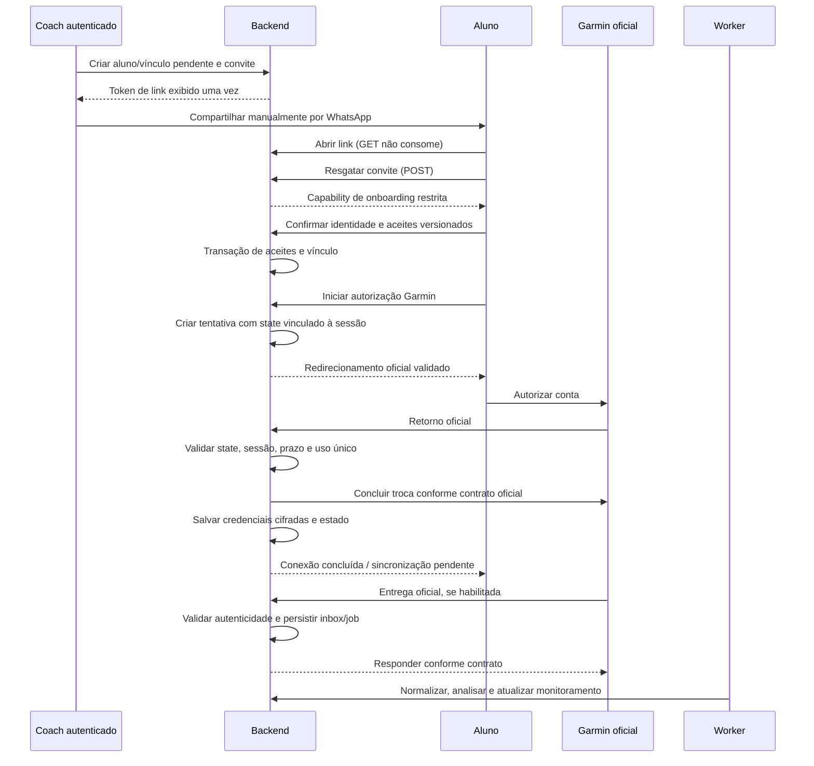

# Integração Garmin

Status: infraestrutura/mock da SPRINT 04 implementados em revisão; provider oficial bloqueado por dependência externa. Nenhum endpoint, payload ou escopo Garmin foi presumido. Consulta pública atualizada: 2026-11-18. As seções de fluxo oficial abaixo continuam desenho condicionado ao acesso autorizado.

## Evidência pública e dependências

A [visão oficial do programa](https://developer.garmin.com/gc-developer-program/overview/) distingue Personal, Business Starter e Business Enterprise. Starter anuncia entrega push, capacidade limitada e ausência de histórico; Enterprise oferece alternativas de entrega e histórico conforme condições. Portanto, backfill e polling não são garantias do MVP. Personal destina-se aos próprios dados e não deve ser assumido como solução para alunos de uma plataforma comercial.

A implementação comercial depende de acesso Business adequado, credenciais, documentação privada e termos aprovados. A disponibilidade anunciada não prova aprovação da BalduTraining. O fluxo de autorização será confirmado no portal oficial: não deduzir endpoints, scopes, assinatura de callbacks, refresh, limites ou formato de atividades. URL antiga pública de Activity API consultada retornou 404 e não foi usada como contrato.

## Contrato interno — não representa API Garmin

Porta ActivityProvider com operações conceituais: iniciar autorização, concluir autorização, validar/normalizar entrega, recuperar dados apenas quando permitido, revogar e consultar estado local. Implementação atual GarminMockProvider; adapter oficial futuro condicionado ao contrato autorizado, ainda ausente. DTOs internos descrevem identidade de origem, revisão, timestamp, unidades, disponibilidade e evidência de proveniência; o domínio não importa DTO Garmin.

Mock usa identificadores próprios, relógio controlável e dados isSynthetic=true/source=garmin_mock. Simula sucesso, recusa, expiração, duplicata, atualização, atraso, entrega fora de ordem, payload inválido, indisponibilidade e revogação. Não acessa contas reais. Inicialização de produção falha se provider mock estiver habilitado; seeds nunca criam conexão oficial.

## Convite e autorização

Token de convite com pelo menos 32 bytes aleatórios criptograficamente seguros; persistir somente hash. Não consumir em GET: previews do WhatsApp e scanners não podem esgotar convite. Remover token da URL após resgate, bloquear referrer e analytics na jornada e não registrar caminho com segredo. Erros públicos genéricos evitam enumerar alunos. Capability de onboarding não é sessão de coach.

State imprevisível, expira e é consumido atomicamente; PKCE e detalhes OAuth conforme documentação oficial. Vincular tentativa a coach, athlete, conexão e navegador. Callback não aceita athleteId/coachId livres para reassociação. Revalidar vínculo/consentimento antes de salvar tokens; callback repetido não cria outra conexão. Em falha/recusa, manter estado recuperável e não exibir sucesso; refresh concorrente deve ser serializado. Tokens nunca chegam ao browser ou logs.

## Ingestão e processamento

1. Validar tamanho, formato, autenticidade e replay conforme contrato oficial. Sem mecanismo confirmado de autenticidade, ingestão oficial permanece desabilitada; não inventar HMAC.
2. Resolver destinatário por conexão autorizada, sem confiar em coachId fornecido pelo emissor. Eventos desconhecidos vão para quarentena com retenção curta; não criar aluno automaticamente.
3. Persistir inbox e job na mesma transação, usando fila transacional PostgreSQL ou outbox se a biblioteca não compartilhar transação. Acknowledgement apenas depois da durabilidade, segundo exigência oficial; banco indisponível resulta em falha retriável conforme contrato.
4. Worker reivindica job com lease, timeout e recuperação após crash. Entrega pelo menos uma vez, efeitos idempotentes; não prometer exactly-once. Chave de evento é definida pelo contrato real; deduplicação por hash é auxiliar, não substitui ID de atividade/revisão.
5. Normalizar unidades, horário/timezone, amostras faltantes, pausas e qualidade. Nunca fabricar FC/cadência/elevação. Raw cifrado e minimizado, retenção curta a definir; FIT/parser só se formato e necessidade forem confirmados.
6. Calcular métricas e eventos determinísticos versionados. Ritmo depende de distância e duração válidas; splits por km exigem amostras de distância suficientes; sem elas, marcar indisponível. Separar moving/elapsed time e não inferir esforço ou fadiga como fato. Comparação de segmentos exige bases temporais/distâncias compatíveis.
7. Interpretar com IA apenas após análise determinística e dentro de contexto autorizado. Evidências apontam activityRevision, intervalo, medida e regra. Histórico limitado ao mesmo aluno/coach e mesma origem real ou sintética.
8. Persistir resultado e evento de monitoramento atomicamente. Falha de IA não invalida atividade nem métricas; repetir apenas etapa falha. Publicação verifica se a revisão ainda é corrente e se o acompanhamento continua autorizado.

Retry proposto: backoff exponencial com jitter, máximo de cinco tentativas para erros transitórios, respeitando limites externos; autenticação inválida exige reconexão, payload inválido vai para quarentena. Dead-letter persistida com código sanitizado e reprocessamento autorizado/auditado. Não executar polling de histórico sem direito contratual. Conciliação deve usar somente capacidades efetivamente aprovadas.

## IA e rastreabilidade

Prompt recebe dados mínimos normalizados, não credenciais, nome, e-mail ou localização por padrão. Saída estruturada diferencia fato, evento, hipótese e recomendação; valida evidências e rejeita métricas ausentes ou referências não autorizadas. Notas do coach são conteúdo não confiável para instruções ao modelo. Perguntas históricas usam consultas autorizadas prévias, sem SQL livre gerado pelo modelo. Resposta cita atividade/revisão/intervalo; quando faltar dado, informa insuficiência. Provider, política de retenção, custos e transferência de dados aguardam escolha.

## Desconexão e exclusão

Desconexão local bloqueia novas ingestões e jobs imediatamente e limpa/revoga tokens conforme contrato. Falha externa mantém revogação pendente, com retry e visibilidade. Revogação notificada pela Garmin deve invalidar conexão/sessões de autorização. Separar fim do vínculo, retirada de consentimento e revogação Garmin. Exclusão remove derivados e payloads conforme política, cancela jobs e mantém somente evidência mínima legalmente justificada; eventos tardios não ressuscitam dados.

## Checklist antes do provider oficial

Confirmar programa/plano, acesso e contrato, protocolo e URLs oficiais, scopes mínimos, PKCE/refresh, autenticação de entregas e retries, IDs/revisões, formatos/amostras disponíveis, limites, replays, histórico, revogação e restrições de múltiplas conexões. Testar sandbox/ambiente autorizado e deidentificar fixtures conforme termos. Sem essas respostas, apenas o mock pode sustentar desenvolvimento local.

## Aluno após a conexão e evolução futura

Na SPRINT 03, projetar mecanismo público seguro de retirada de autorização e solicitação de encerramento, com token de finalidade restrita e confirmação de identidade, sem conta de dashboard. Na SPRINT 04, integrar suas consequências à desconexão e aos jobs. Não reutilizar capability expirada de onboarding para gestão permanente.

SPRINT 05 admite importação manual de FIT para desenvolvimento, separada de sincronização oficial. Validar formato com parser mantido, tamanho máximo, quantidade de amostras, tempo/memória de processamento e checksum; tratar arquivo como não confiável, não usar nome enviado como caminho e não persistir GPS sem necessidade. Fonte `manual_fit` indica upload, não prova de origem/autenticidade Garmin ou veracidade das medições. Idempotência por tenant/arquivo e identificação de possíveis duplicatas com sincronização precisam de regra explícita, sem descartar silenciosamente atividades por similaridade.

MVP 2: treino estruturado (aquecimento, esforço/repetições, recuperação, desaquecimento, metas, duração/distância) e status de publicação para aluno poderão usar adapter de envio separado se a Training API oficial permitir. Não criar schema, endpoints ou provider de envio no MVP 1. Não prometer histórico ou sincronização instantânea.

## Fronteira implementada na SPRINT 03

A jornada de convite e os aceites demonstrativos foram implementados sem provider Garmin, credenciais, tentativa OAuth ou conexão. Confirmação e perfil mantêm Garmin não conectada; não existe botão que simule autorização oficial concluída. Encerramento público retira aceites de teste e encerra apenas o vínculo local. Integrar revogação de conexão e bloqueio de jobs requer a SPRINT 04 autorizada e os contratos oficiais quando disponíveis.

## Implementação demonstrativa da SPRINT 04

Ver [ADR-004](../decisions/adr-004-garmin-processing.md). GARMIN_PROVIDER=disabled por padrão; mock exige AUTH_MODE=demo, origem/bind locais, fora de produção, chave de criptografia e chave de assinatura válidas e estáveis. pnpm garmin:setup gera chaves no .env ignorado, sem exibi-las. Nenhuma senha Garmin, credential ou segredo de assinatura chega ao frontend.

Aluno com aceites inicia tentativa de dez minutos, state aleatório de uso único e hash do navegador/enrollment; tela /garmin/mock explicitamente BalduCore permite aprovar/recusar, sem redirecionar a domínio Garmin ou autenticar conta real. Credenciais sintéticas do adapter são cifradas com chave externa ao banco. Falha de autorização é registrada; callback revalida vínculo/geração e compensa autorização cancelada. Renovação tem lease de dez segundos e versão, evitando sobrescrita concorrente ou restauração depois de disconnect. Ao expirar a sessão inicial, coach pode emitir convite de finalidade conexão, com nova verificação e aceites anteriores preservados.

Contrato de entrega **exclusivamente mock**: POST /integrations/garmin-mock/events, X-Baldu-Mock-Timestamp (segundos UTC) e X-Baldu-Mock-Signature (HMAC SHA-256 hexadecimal de timestamp + ponto + bytes do corpo bruto). Janela de cinco minutos, limite JSON 16 KiB, DTO estrito de entrega e normalização. Isso não descreve autenticação Garmin real. Conta é resolvida pelo hash de conexão conhecida; evento não pode escolher coachId/athleteId. Assinatura inválida é rejeitada, conta desconhecida/inativa não cria aluno nem atividade. ACK 202 representa recebimento durável, não processamento concluído.

Inbox e job pg-boss são atômicos via fromPrisma. Identidade de entrega e hash evitam duplicação/colisão; mesmo externo usa revisão monotônica, eventos antigos são ignorados e conteúdo conflitante na mesma revisão falha. Worker separado trata envelope mínimo sintético com null em métricas ausentes. pg-boss: prazo de execução de 30 segundos, quatro retries (cinco tentativas), atraso inicial de um segundo e backoff. Erros permanentes/exauridos ficam failed na inbox para revisão manual; redrive valida dono/estado do recurso. Payloads cifrados não são colocados no job, que carrega apenas referência.

Publicação revalida vínculo ativo/aceites, conexão/geração e fencing da execução. Disconnect/retirada impedem imediatamente recebimento e publicação, limpam credenciais ativas e persistem revogação. Falha externa mantém pendência com coleta bloqueada; sucesso limpa o snapshot cifrado. Revogação assinada pelo provider mock bloqueia localmente sem reativação por entregas antigas. Cancelar conexão não encerra vínculo; retirar acompanhamento encerra vínculo e desconecta.

Ferramentas locais no perfil simulam atividade, duplicata, atualização, versão antiga, falhas temporárias/permanentes, payload inválido, expiração/refresh rejeitado, revogação e indisponibilidade de revogação. Não há sincronização automática com uma conta real. Perfil/lista/Configurações distinguem mock, status, pendências e disponibilidade do processamento. API não fornece histórico esportivo completo até a SPRINT 05.

Bloqueio oficial verificado na inspeção: nenhum acesso/credencial ou documentação autorizada fornecidos. A página pública oficial confirma opções Business, mas não substitui aprovação da aplicação. Antes de habilitar produção, confirmar contratos listados no checklist, políticas jurídicas/retenção e deploy/migração/rotação de chaves. Não promover o mock a provider oficial por configuração.
